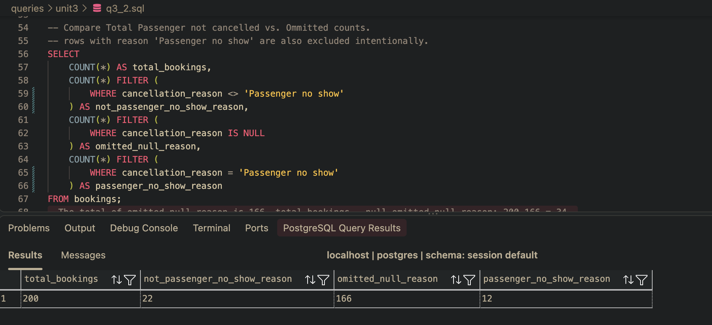
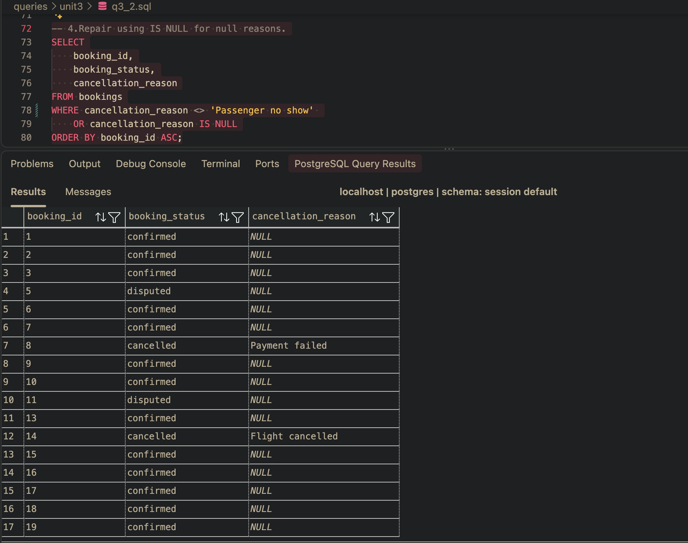
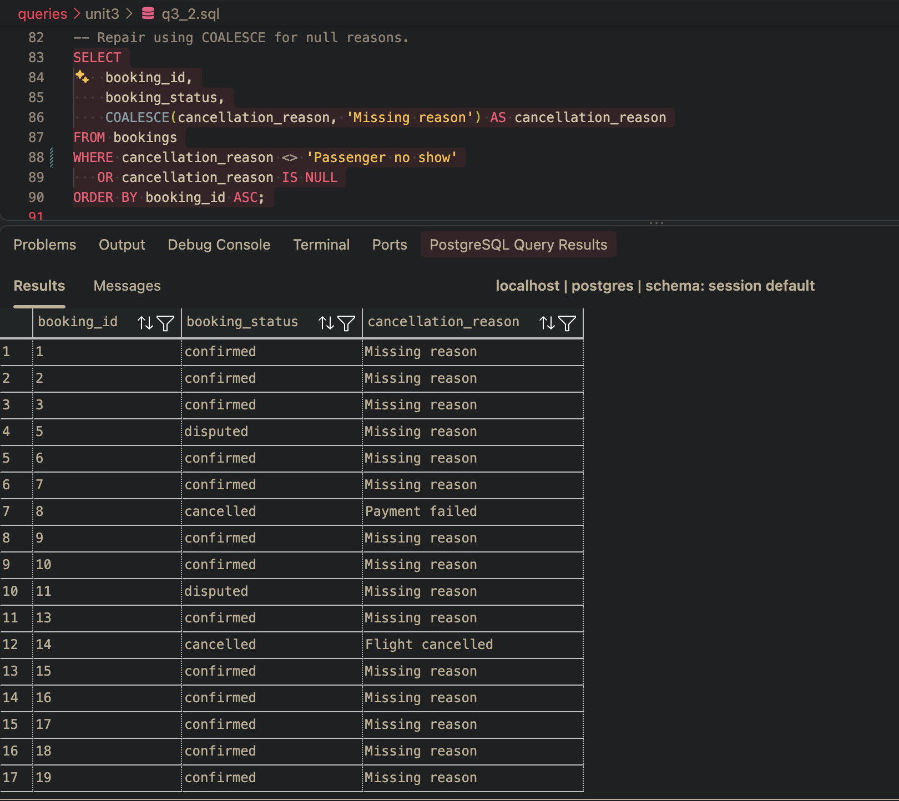
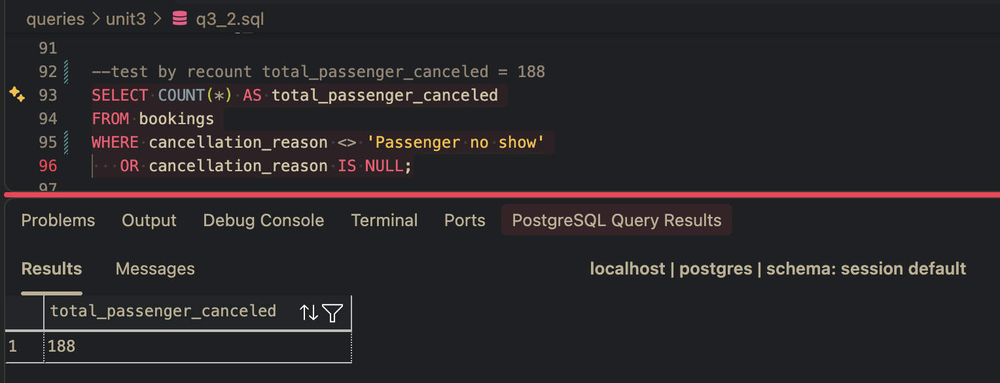
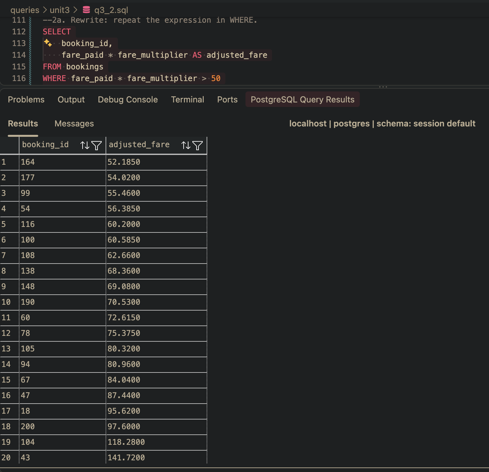
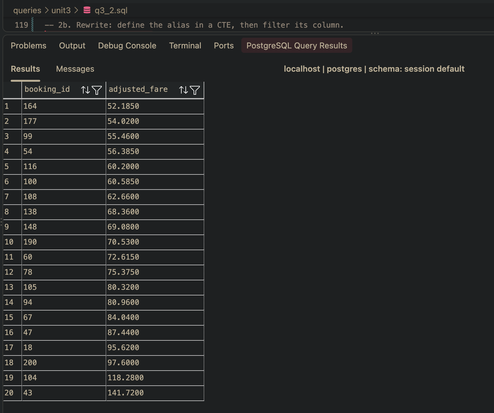

## Task 3.2 Part A: the two row counts and the table total together, so a reader can see they do not sum. 
The total of omitted_null_reason is 166 

total_bookings - null omitted_null_reason: 200-166 = 34.

## Repaired query returning the full count.

Fix: UsingIS NULL

Fix: Using COALESCE

Post Fix Re-count testing: total_passenger_canceled = 192

## Task 3.2 Part B: the failing query and its verbatim error message in one capture, followed by both rewrites running.

## 1. defining an alias in SELECT and referencing that alias in WHERE. Capture error message.

## 2a. Rewrite: repeat the expression in WHERE.

## 2b. Rewrite: define the alias in a CTE, then filter its column.

