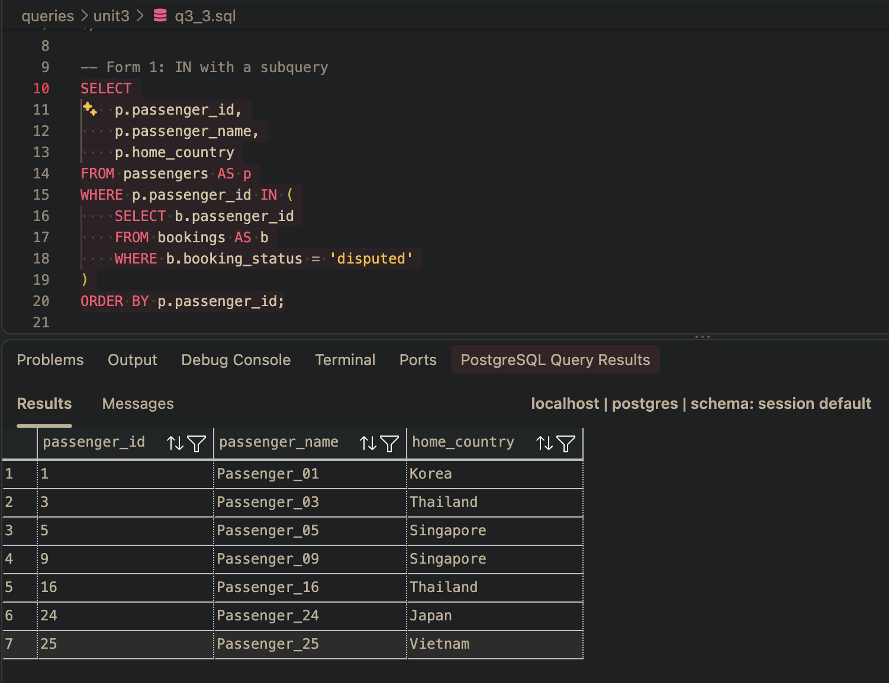
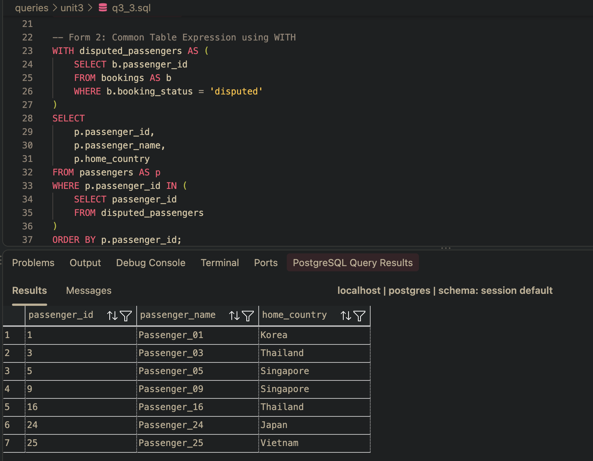
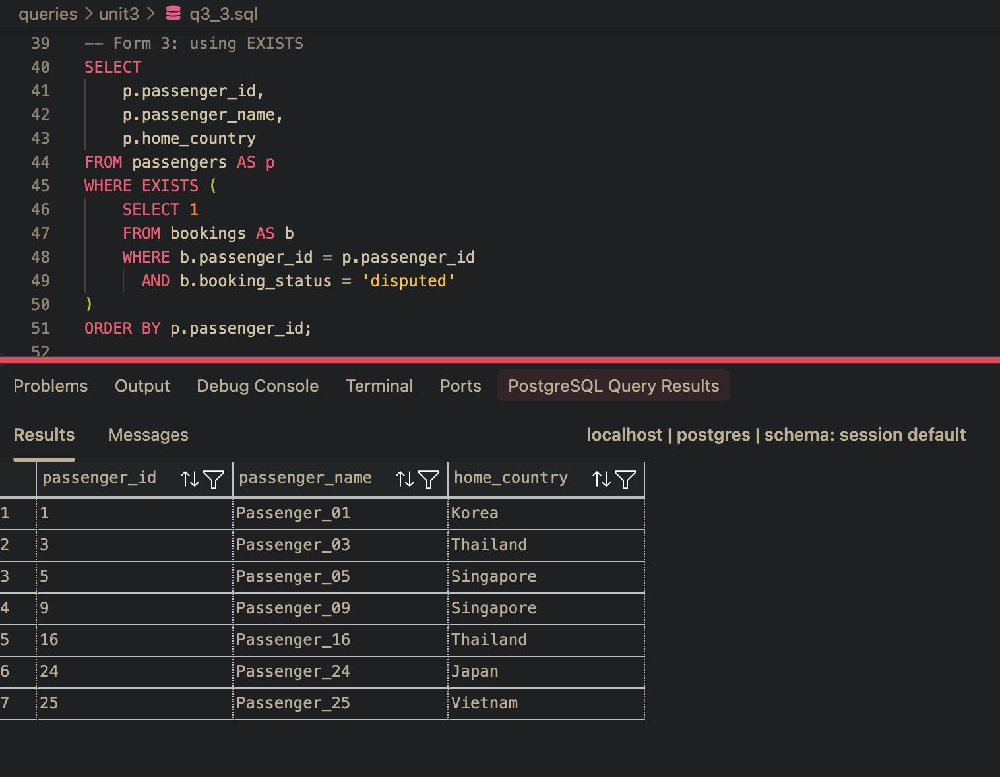

 ## Task 3.3: all three forms running, with output that makes the identity of the result sets checkable rather than asserted.

-- Form 1: subquery with IN

 

-- Form 2: Common Table Expression using WITH

 

-- Form 3: correlated EXISTS

 

