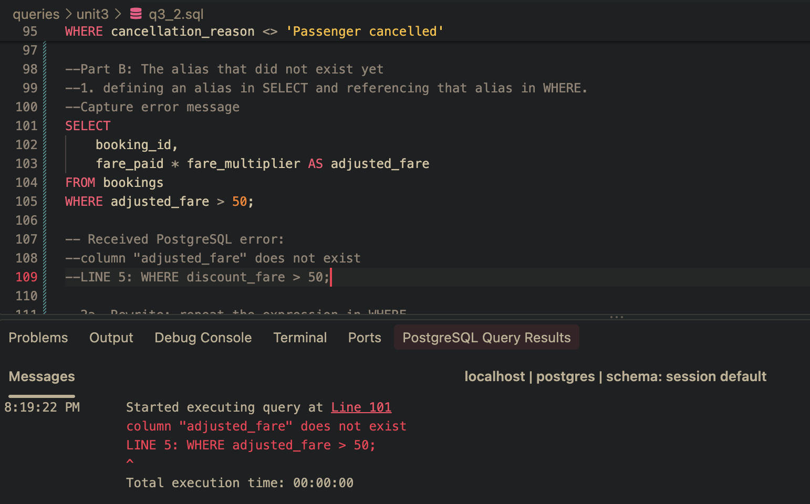

 ## Task 3.3: all three forms running, with output that makes the identity of the result sets checkable rather than asserted.

-- Form 1: IN with a subquery

 

-- Form 2: CTE followed by IN

-- Form 3: correlated EXISTS

