### unit 4 Screenshots SQL
## Task 4.1 
>## 1 - Count, total, average, minimum, and maximum of your Paw Air flight across the bookings. 

- Event table (bookings) metrics, relationship between fare paid and each distinct passenger who booked a flight  

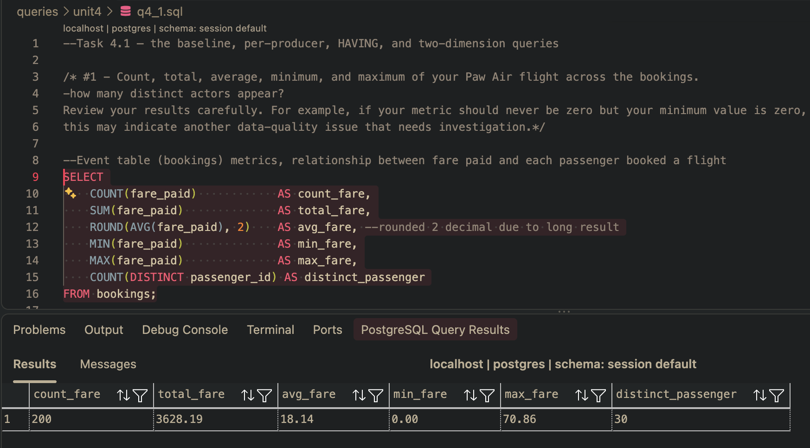

- Min_fare indicated 0.00, because constrain allows (fare_paid >= 0), reflects data quality issue. (later query indicates 0.00 fare paid are cancellation flight fare)

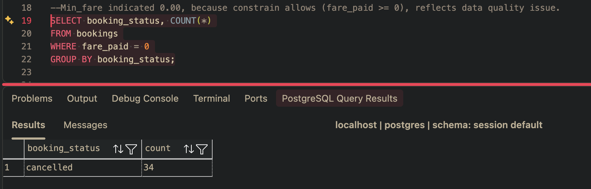

>## 2 - Booking count and average metric for each flights. 

- Join only show flights that have booking, not counting 0 or NULL
- japan top booked origin country, avg fare are similar and booking count in smaller and larger flights almost the same indicating larger planes with higher seat capacity are not needed. 
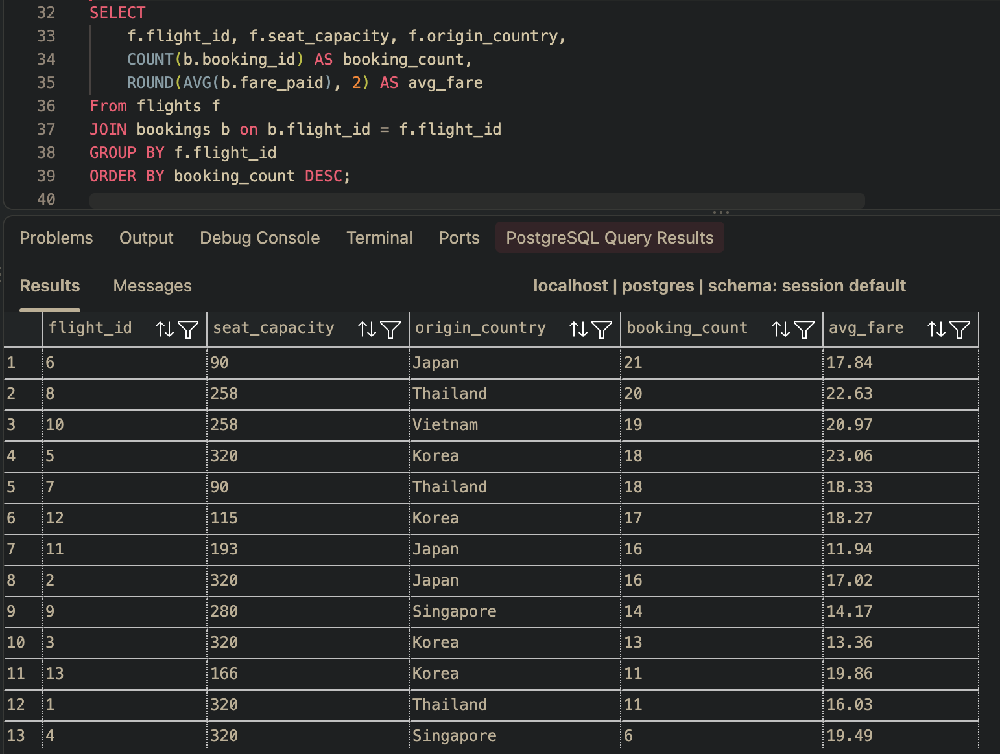

- Comparing LEFT join show flights also with 0 or NULL booking
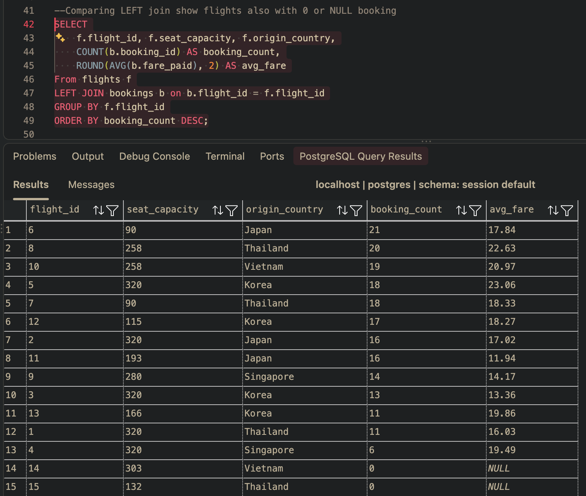

- Additional analysis on each flights booking status count (canceled, confirmed, dispute) below:
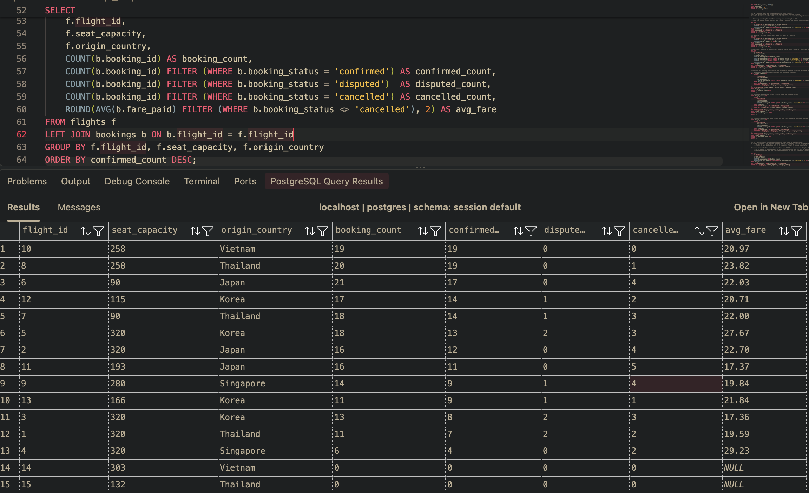

- pick the MIN booking confirmation and MAX booking dispute flight to determine which flight might be root cause of previous frozen pay out 
- Max Dispute bookings shows flight #3 from Korea has 2 dispute
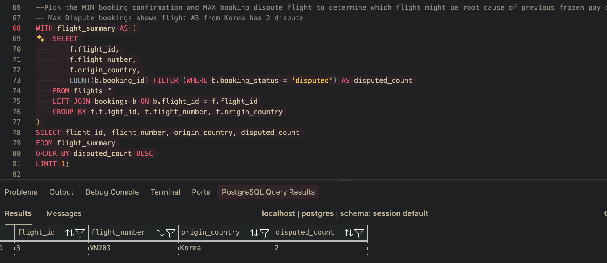

- Max cancelled bookings flight #11 from Japan has 5 cancellation
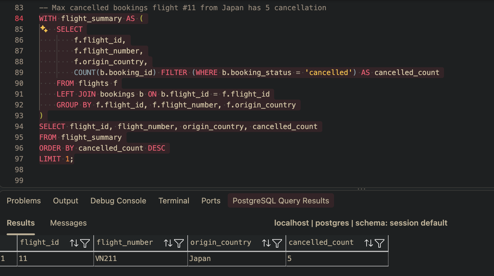

- Min confirmed bookings shows flight #15 from Thailand has 0 confirmed booking 
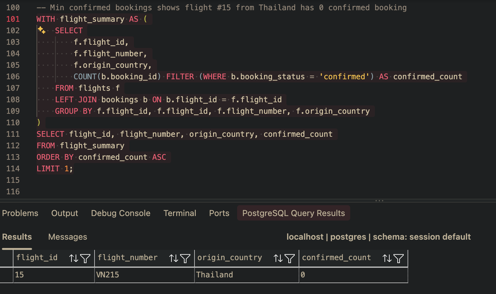

>## 3 - Which flights have enough volume for their rate to mean anything? 
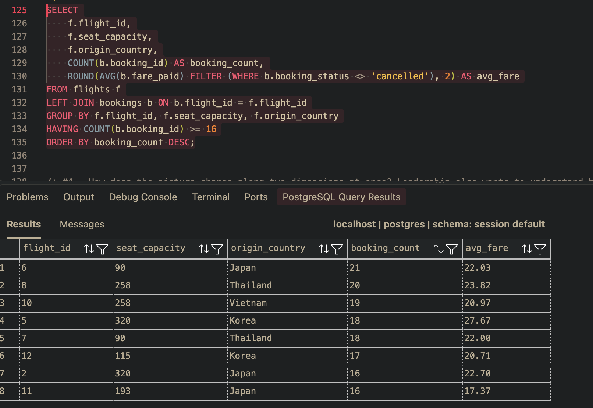

>## 4 - How does the picture change along two dimensions at once? Leadership also wants to understand how performance varies across regions.
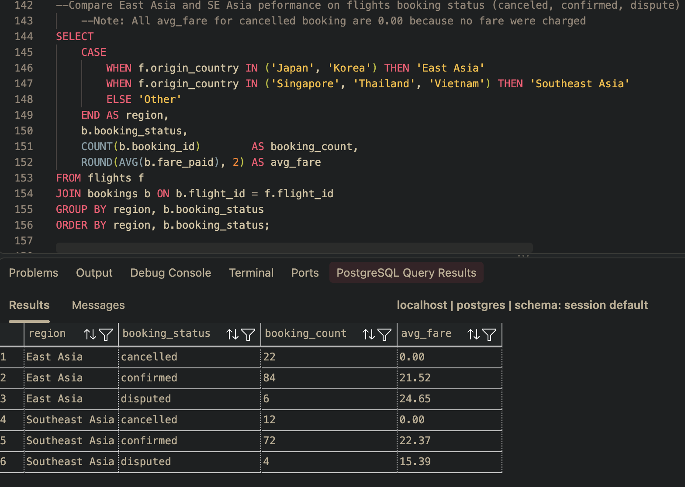

------------
## Task 4.2 — conditional aggregation, ROLLUP, and the pipeline. 
>## Part A: Two numbers in one pass 
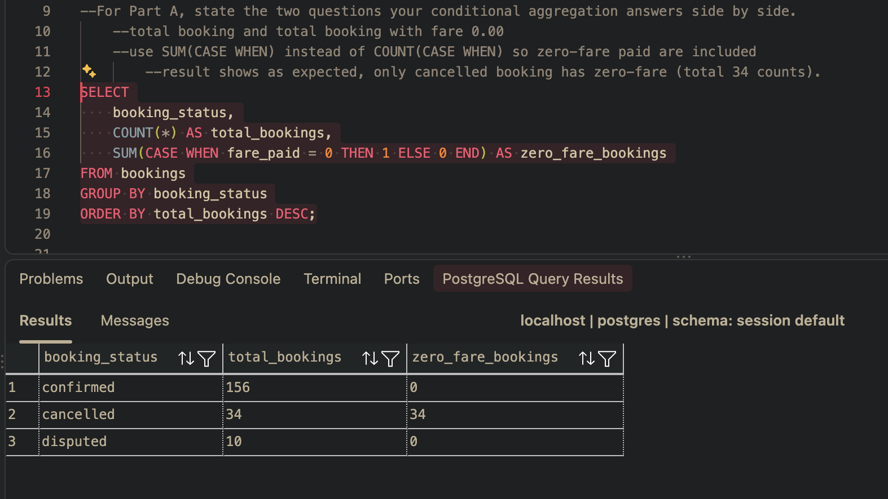

>## Part B: Subtotals and a grand total
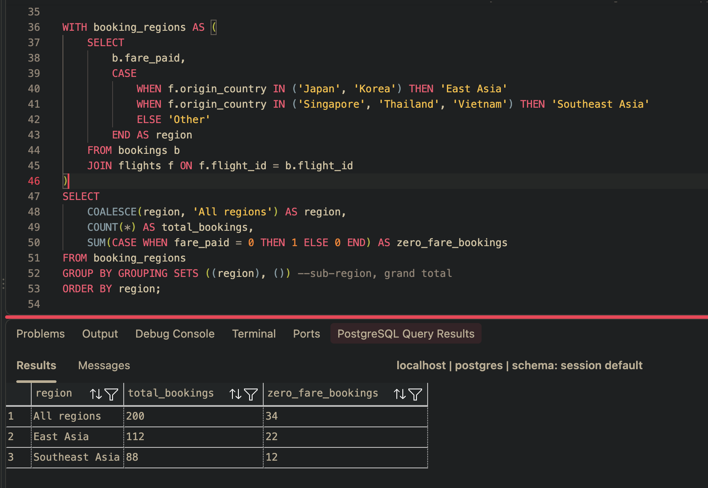

>## Part C: A two-step pipeline
- Avg fare and zero_fare paid for high-volume flights with booking_count >= 16
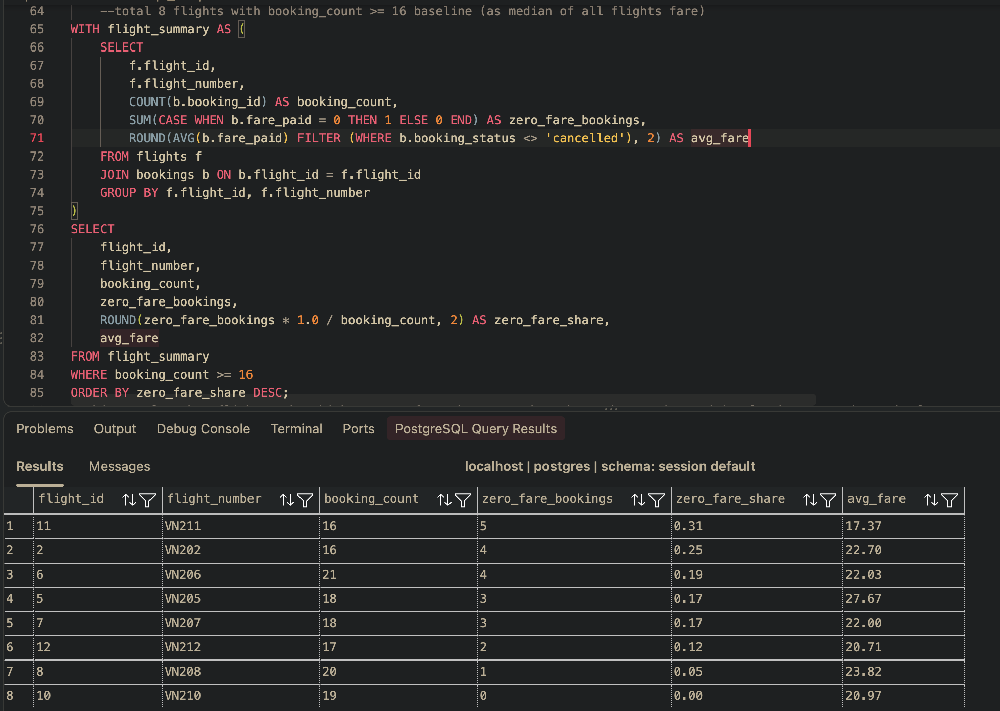

- Note: Added second aggregation
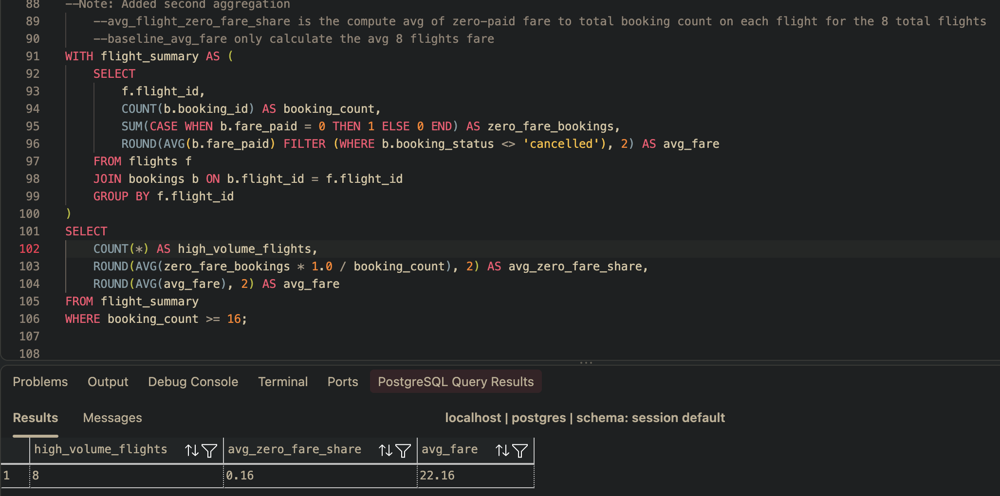

- Additional analysis: each of the flight's zero-fare (baseline) share tells flight#4 has zero fare share of 33% will need closer look 
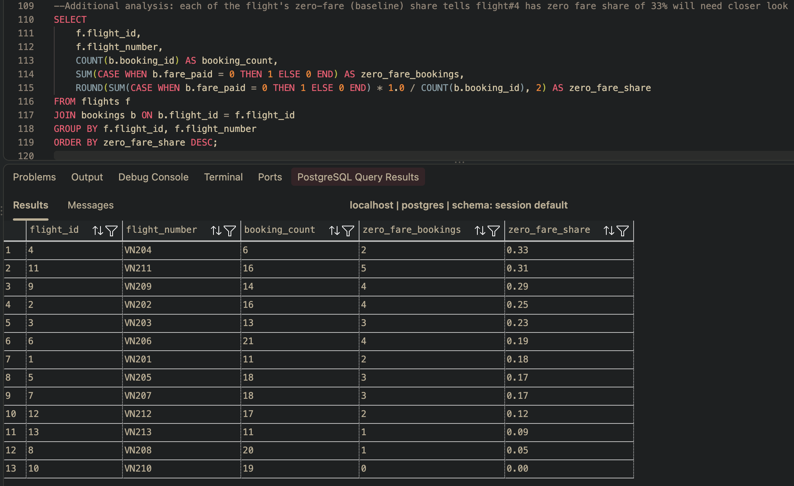